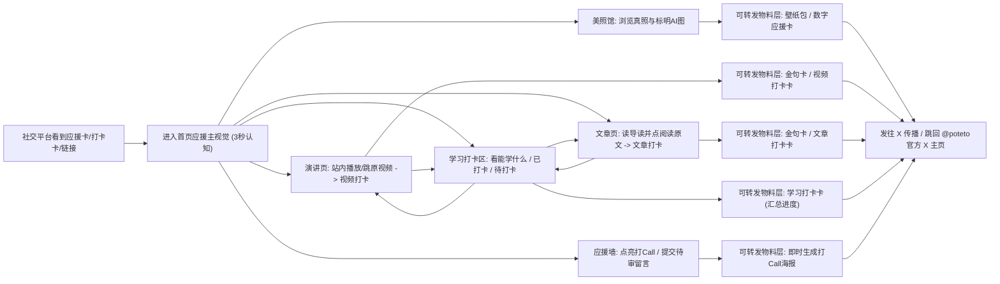
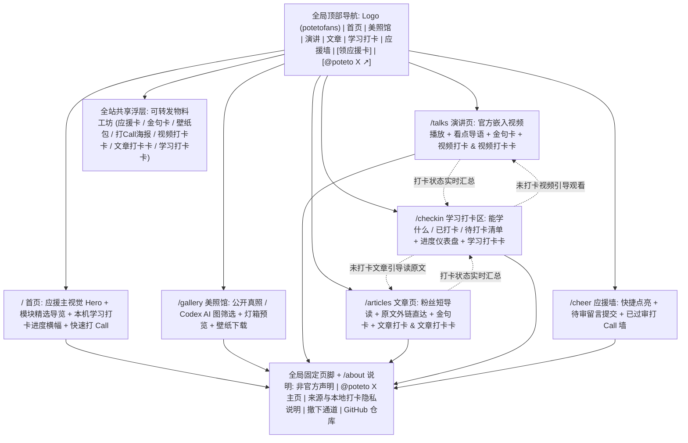

# potetofans 产品需求文档（PRD）

- **文档版本**：v1.1（第一期立项修订可交付版）
- **撰写日期**：2026-11-19（Asia/Shanghai，UTC+8）
- **产品名称**：potetofans
- **应援对象**：X 账号 [@poteto](https://x.com/poteto)（中文社区昵称：「土豆女神」）
- **站点性质**：非官方民间粉丝应援站（Unofficial Fan Tribute Site）
- **代码仓库**：[https://github.com/KinGao294/potetofans](https://github.com/KinGao294/potetofans)（公开仓库，已创建；当前仅含最简 `README`，尚无站点代码）
- **域名状态**：建议主域名 `potetofans.com`（经 Vercel 注册商查询当前可注册，首年约 `$12.03`、续费约 `$12.03`/年，**尚未购买**；同名 `potetofans.dev`、`potetofans.app` 当前亦可购买，同样**尚未购买**）
- **交付对象**：UI/UX 设计师、前端/全栈工程师

### 版本修订说明（v1.0 → v1.1）

| 版本 | 日期 | 核心变更摘要 |
| :--- | :--- | :--- |
| **v1.0** | 2026-11-19 | 完成第一期立项基线版，确立首页应援主视觉、美照馆、演讲、文章、应援墙、可转发物料层、页脚与关于声明七大模块及合规红线。 |
| **v1.1** | 2026-11-19 | **响应发起人新增诉求，将「学习打卡区」「视频打卡」「文章打卡」正式纳入第一期（MVP 必做范围）**： 1. 新增独立入口与枢纽模块**「学习打卡区」**，把公开演讲与文章组织成「能学什么、打过哪些卡、还能打哪些卡」的可完成学习清单（拒绝百科化堆砌）； 2. 在现有「演讲」模块挂载**「视频打卡」**，在现有「文章」模块挂载**「文章打卡」**，基于真实播放/原文跳转后的自证机制完成打卡，并统一汇总至「学习打卡区」； 3. 打卡成功后支持生成**「学习打卡卡 / 视频打卡卡 / 文章打卡卡」**，全面接入「可转发物料层」； 4. 同步修订信息架构、路由规划、数据契约、分期规划（原二期「应援印章任务」已被一期学习打卡体系吸收，改写二期范围避免重复建设）、成功指标、已确定/待确认事项及下一步计划。 |

---

## 1. 版本与背景

**结论：potetofans 是一个纯粹为「土豆女神」（[@poteto](https://x.com/poteto)）打 Call 的非官方粉丝站，核心是用韩系高审美视觉、轻量共学打卡清单与可转发应援/打卡物料承接粉丝喜爱，把「看美照惊艳」与「学演讲文章成长」合二为一，并把关注与真实阅读/观看流量导回她的官方渠道，而非做人物百科或冒充官网。**

### 1.1 事实基线（严格以可核对事实为准，禁止编造）
1. **已核实对象信息**：应援对象为 X 平台创作者 [@poteto](https://x.com/poteto)，中文昵称「土豆女神」。关于其真名、职位、国籍、就职公司、教育及职业履历等信息，**本文档及未来站点一律不自行编造或推测，统一以她公开主页（[https://x.com/poteto](https://x.com/poteto)）实时公开内容为准，建站填充内容时再逐项核对**。
2. **已核实工程与资产现状**：GitHub 公开仓库 [KinGao294/potetofans](https://github.com/KinGao294/potetofans) 已建立，目前仅有最简 `README`，无历史代码包袱，可从零按现代静态/轻量全栈架构设计；域名 `potetofans.com`（及 `.dev` / `.app`）经 Vercel 查询可买但**尚未购买**。
3. **发起人核心诉求（含 v1.1 第一期新增必做项）**：
   - **四大基础内容与互动支点**：**高清美照**（先搜集公开真照，再用 Codex 按同一风格生成更多同风格延伸图，生成图必须标明 AI 生成）、**公开演讲视频**、**她的文章**（短导读 + 原文链接，不整篇转载）、**应援打 Call**；
   - **三大第一期必做打卡能力**：**学习打卡区**（独立入口与清单枢纽）、**视频打卡**（挂靠演讲模块并汇总至学习打卡区）、**文章打卡**（挂靠文章模块并汇总至学习打卡区），且打卡完成后必须能生成可带走、可转发的**「学习打卡卡 / 视频打卡卡 / 文章打卡卡」**；
   - **全站合规底线**：全站页脚必须保留其 X 主页链接并注明非官方粉丝站。

### 1.2 韩国艺人/饭制站点调研与转化结论（推断与方法论转化）
基于对韩国女爱豆/女演员三类代表站点的拆解，本站只吸收「视觉冲击力」「打卡仪式感」与「社交转发机制」，剥离官方商业平台属性：

| 对标类型 | 代表案例 | 核心有效机制 | potetofans 转化方案（做什么 vs 不照搬什么） |
| :--- | :--- | :--- | :--- |
| **官方艺人主页** | `aespa.com`、`newjeans.kr`、YG BLACKPINK 艺人页 | 首屏大视觉定调，3 秒建立气场；作品/舞台入口极简清晰 | **吸收**：画报级应援首屏，直达美照、演讲舞台、文章观点与学习打卡枢纽。 **不照搬**：不伪装官方门户，不写冗长官方履历词条。 |
| **官方饭制平台** | Weverse、Berriz、SMTOWN | 数字纪念卡、写真归档、轻量打卡印章、陪伴成长仪式感 | **吸收**：一期直接落地免登录「数字应援卡」与「学习打卡体系（视频打卡 + 文章打卡 + 学习打卡区汇总 + 可分享打卡卡）」，把追星仪式感升华为正向共学动力。 **不照搬**：**不做付费会员、不做 VIP 等级、不做官方周边商城、不做假私信（DM）**。 |
| **民间粉丝应援站** | `remine.ing` 等韩系个站 | 高清壁纸包、포카（小卡）风格收藏图、金句/应援海报、公开日程 | **吸收**：把「能收藏、能打卡、能一键出图发出去」做成贯穿全站的转发引擎；公开行程留待二期。 **不照搬**：不追踪任何非公开私人行程，不搬运未授权私照。 |

---

## 2. 一句话目标

**打造一个 3 秒看懂身份与非官方边界、兼具韩系画报质感与共学成长仪式感的「土豆女神（@poteto）」粉丝应援站，让访客不仅能沉浸浏览她的美照、把她的公开演讲与文章作为可完成清单认真观看阅读并打卡，更能一键生成应援卡、学习/视频/文章打卡卡、金句卡、壁纸或打 Call 海报分享出圈，顺畅回流关注她的官方 X 主页。**

---

## 3. 产品原则

**结论：所有设计与工程决策遇到冲突时，按「合规透明 > 可转发体验 > 视觉审美 > 资料堆砌」的优先级裁决。**

1. **打 Call 与共学并重，拒绝百科化**：本站卖点是「喜爱、共鸣、向她学习与安利」，不是维基百科。只精选最能体现她魅力的高光美照、代表性演讲与核心文章；「学习打卡区」是可行动、有进度的精选学习清单，不追求「资料最全」，不堆砌未经证实的个人背景。
2. **真假分明，诚实自证**：公开真照与 Codex 生成的同风格 AI 图必须在视觉、交互与导出文件三个层面彻底区分；非官方声明与官方 X 导流常驻可见；**视频打卡与文章打卡采用「前置触达解锁 + 诚实自证」机制，建立在真实站内播放或跳转原链接之后，绝不假装能跨站精确监控访客「看完了每一秒/每一字」**。
3. **尊重原创，只导流不截流**：文章只做短导读与原句微摘录，100% 链回原文；演讲只用官方公开嵌入与原链，不盗链重托管视频源文件。**绝不为了做打卡而搬运全文或重托管视频，打卡不得替代原视频观看与原文阅读，而是驱动访客真正去听演讲、读原文的正向激励**。
4. **每个浏览与打卡终点都接一个「可带走物料」**：看美照可存壁纸/做小卡，看演讲与文章可出金句卡，完成视频/文章/清单学习可出「视频打卡卡 / 文章打卡卡 / 学习打卡卡」，写应援语可出打 Call 海报。拒绝只有一个不能带走、不能分享的干瘪勾选状态。
5. **免登护隐私，公开必先审**：第一期默认零账号注册门槛，使用浏览器本地存储记住本人学习打卡进度，不收集个人隐私、不做强制注册的学习档案；不把打卡做成免审公开垃圾墙（一期聚焦「本人本地进度 + 可转发打卡卡」），但凡涉及公开上墙的用户输入内容，一律执行先审后发。

---

## 4. 用户与主路径

**结论：围绕「老粉安利出图」「路人/新粉入坑导流」「共学粉丝打卡出卡与持续回访」三条闭环路径设计页面流转，确保任意内容与打卡终点在 2 次点击内都能完成「生成转发物料」或「跳转官方 X」。**

### 4.1 核心目标用户（基于站点定位推断）
1. **核心应援粉（传播发起者）**：已在 X 关注 `@poteto`，熟悉她的观点或个人魅力，需要好看的壁纸、小卡、金句图、打卡卡和打 Call 海报在社交平台安利同好。
2. **社交裂变路人 / 潜在新粉（主要增量访客）**：在 X 或社群看到别人晒出的应援卡、学习打卡卡、金句卡或站点链接点进来，希望在几十秒内搞清楚「土豆女神是谁、有什么魅力、大家在学她的什么内容」，进而去她的 X 点关注。
3. **内容共鸣与学习打卡型访客（深度停留与回访者）**：被她的公开演讲或深度文章吸引，希望把她的公开作品当作一份「跟着女神精进的学习清单」，看完一场演讲、读完一篇原文后认真打卡记录进度，并导出打卡卡分享收获、后续回访刷完剩余清单。

### 4.2 核心用户主路径

---

## 5. 模块与价值（第一期核心需求定义）

**结论：第一期共包含 8 个有机咬合的核心模块。模块 1～6 负责建立视觉认知、承接内容消费、组织共学打卡（含挂靠于演讲的「视频打卡」、挂靠于文章的「文章打卡」及独立枢纽「学习打卡区」）与激发集体应援情绪；模块 7（可转发物料层）作为底层共享引擎承接 7 类应援与打卡物料导出；模块 8 兜底全站合规与官方导流。**

---

### 5.1 模块一：首页应援主视觉（Hero & 首屏导流区）

- **独立价值**：决定访客前 3 秒的去留与定性认知。第一时间用韩系画报舞台感立住「土豆女神（@poteto）」的形象，同时一眼交代清楚「这是谁、这是非官方粉丝应援站、下一步去哪看/怎么跟着学打卡或打 Call」。
- **不做会损失什么**：若做成传统博客列表或人物词条页，新访客会误以为是枯燥资料库而直接跳出；若缺少首屏级非官方提示与 X 直链，极易引发「冒充本人官网」的误解。
- **做什么**：
  1. **画报级主视觉区**：展示精选公开真照主视觉（或明确标注的舞台风概念排版），突出 `@poteto` 标识与中文昵称「土豆女神」。一句话应援副标题与身份简介**严格以她公开主页（[https://x.com/poteto](https://x.com/poteto)）最新信息为准，建站时核对填入**。
  2. **首屏身份角标**：主标题旁或首屏显眼位置固定展示 `Unofficial Fan Tribute · 非官方粉丝应援站` 胶囊标签。
  3. **首屏双层行动点（CTA）**：
     - 主 CTA：`领取数字应援卡 / 为她打 Call`（直通物料生成或应援墙）。
     - 次 CTA：`进入学习打卡区`、`进入美照馆`、`访问 @poteto 的 X 主页 ↗`。
  4. **首屏下方轻量精选导览**：向下滚动可预览 3～4 张精选美照、1 条代表性演讲视频入口、2 篇精选文章导读卡片、**本机学习打卡进度轻量横幅（如「跟着土豆女神学习：本机已完成 X / Y 项打卡 → 去打卡区」）**及最新已过审应援语跑马灯/卡片，引导进入各专页深度停留。
- **不做什么**：
  1. 不编写未经核实的出生年月、真名、国籍、公司职级或百科式长篇履历。
  2. 不使用蓝 V 认证图标、官方徽章或第一人称（「欢迎来到我的主页」）等误导性视觉元素。
  3. 不做阻断式开屏弹窗、强制背景音乐自动外放或注册登录拦截。
- **验收标准**：
  1. 在桌面端（`1440×900`）与移动端（`390×844`）首屏不滚动状态下，100% 同时可见：`@poteto` /「土豆女神」名称、非官方粉丝站标识、主应援按钮、跳转其 X 主页入口。
  2. 首屏找 3～5 名首次访问测试者盲测，均能在 3 秒内准确回答「这是谁的站」「是不是官方站」「点哪里去打 Call、去学习打卡或去她的 X」。
  3. 首屏最大内容绘制（LCP）在常规 4G/Wi-Fi 环境下 ≤ 2.5 秒。

---

### 5.2 模块二：美照馆（公开真照 + 同风格 AI 应援图）

- **独立价值**：承载韩系应援站最核心的「视觉惊艳感」与「收藏欲」。先汇总散落的公开高清照片建立真实质感，再通过 Codex 按同一审美风格生成的延伸图补足多尺寸壁纸、应援卡与打卡卡底图素材源。
- **不做会损失什么**：不做美照馆，站点将退化为纯文字链接聚合页，失去粉丝站的情感张力与壁纸/卡片视觉底图；但若做了美照馆却不严格隔离标注 AI 图，一旦粉丝把 AI 图当真照传播，将直接透支站点公信力并造成肖像混淆争议。
- **做什么**：
  1. **严格分类与筛选栏**：顶部提供清晰的来源切换 Tab：`全部` / `公开真照（Real Public Photos）` / `AI 灵感生成（Codex AI Tribute）`，并支持按画幅筛选（`手机竖屏` / `桌面横屏` / `方形小卡`）。
  2. **公开真照规范**：仅收录 `@poteto` 在公开社交主页或公开活动官方渠道发布的照片。每张图在详情态展示「公开来源链接（可点击核验）」与发布日期/场景说明（以公开信息为准）。
  3. **Codex AI 生成图规范**：基于公开真照风格特征，使用 Codex 按同一审美方向生成的「同风格概念/应援图」。**执行三重强制标注**：
     - 列表缩略图角落常驻高对比度标签：`AI 生成 · 非实拍`；
     - 灯箱大图预览页醒目说明：`本图为粉丝使用 Codex 按同风格生成的 AI 应援视觉，非 @poteto 本人真实照片`；
     - 任何下载到本地的原图/壁纸/合成应援卡或打卡卡，画面内硬编码保留不可裁切去除的 `AI-Generated Tribute` 微水印。
  4. **灯箱预览与物料直连**：点击任意图片打开高清灯箱，底部提供 `下载手机/桌面壁纸` 与 `用此图制作数字应援卡/海报` 快捷按钮。
- **不做什么**：
  1. 绝不把 AI 生成图混充真照，绝不提供「无 AI 水印版」AI 图下载。
  2. 不收录任何非公开流出的私照、路人偷拍、未经公开的私人聚会照。
  3. 不使用 Codex 生成任何低俗、恶搞、虚假事件新闻图或偏离尊重原则的图像。
- **验收标准**：
  1. 站内 100% 的 AI 图在缩略图态、灯箱详情态、下载后的本地图片文件中均肉眼清晰可见「AI 生成」标识，抽检漏标率为 0%。
  2. 站内 100% 的「公开真照」均带有有效且可跳转核验的原始公开出处 URL。
  3. 切换 `公开真照` 与 `AI 灵感生成` 筛选器时列表即时准确过滤，图片懒加载无闪烁崩塌（CLS ≤ 0.1）。

---

### 5.3 模块三：演讲 & 视频打卡（公开视频嵌入 + 核心看点 + 金句卡 + 视频打卡）

#### 5.3.1 演讲浏览与金句直出能力
- **独立价值**：展现「土豆女神」在公开舞台上的表达力、专业锋芒与个人气场（对应韩系站点的 Stage / Performance 核心板块），把高门槛的长视频转化为易消费、易转发的精华看点。
- **不做会损失什么**：缺失演讲模块会让站点流于表面颜值展示，无法承接被她专业能力吸引的核心受众；若只罗列外部视频链接而不做页内嵌入与金句提炼，访客会直接流失且难以产生二次传播。
- **做什么**：
  1. **合规官方视频嵌入**：采用公开视频平台（如 YouTube 或大会官方公开托管页）标准 `iframe` 嵌入组件（推荐配合轻量点击播放封面遮罩 Click-to-Play Facade 兼顾加载性能与播放动作感知），支持站内直接播放，同时保留显著的 `前往原视频页观看 ↗` 按钮。
  2. **应援视角看点导览**：每场演讲配备结构化卡片，包含演讲原标题、公开活动名称与日期（以原视频公开信息为准）、100 字以内的「打 Call 看点 / 能学到什么导语」及可选关键时间点提示。
  3. **演讲金句直出**：每场演讲提炼 1～3 句公开发言原话（保留原文准确性，可附简明中文参考译注并注明粉丝试译），每句旁配 `生成金句卡` 按钮，一键唤起物料引擎导出社交分享图。
- **不做什么**：
  1. 不抓取、不转录重托管他人拥有版权的视频 `.mp4` 源文件。
  2. 不收录闭门会议、付费专享课程录屏、未经公开授权的线下手机偷录视频。
  3. 不篡改或脱离语境拼接她的发言原意。

#### 5.3.2 视频打卡（挂载于演讲模块，并在学习打卡区汇总）
- **独立价值**：把「看过一场公开演讲」从转瞬即逝的浏览变成有成就感、可留存、可晒出的共学行动。既激励粉丝真正静下心听完她的分享，又通过生成的「视频打卡卡」为演讲内容带来高信任度的口碑安利。
- **不做会损失什么**：若没有视频打卡，访客看完长视频缺少即时正向反馈与完成记录；若只做一个干瘪的本地勾选框而不连带生成「视频打卡卡」，粉丝无法把「我刚学完女神这场演讲」的喜悦分享到社交网络，传播链路断裂。
- **做什么**：
  1. **前置观看解锁 + 诚实自证打卡机制**：
     - 打卡不得替代观看。每场演讲卡片底部挂载「视频打卡」操作栏；初始未触达态按钮提示 `先播放或看原视频后打卡`；
     - 当访客在站内点击触发该场演讲嵌入播放器播放，或点击 `前往原视频页观看 ↗` 跳转原链接后，本机自动将该视频标记为 `可打卡（unlocked）` 状态，按钮激活为 `我已认真看完 · 视频打卡`；
     - 访客点击打卡时，采用诚实自证确认（可附填一句 `1～80 字` 的本机一句话学习收获与昵称，选填不强制），确认后立即写入浏览器本地存储，点亮「已打卡」印章与日期，**实时同步汇总至「学习打卡区」**。
  2. **打卡即出「视频打卡卡」**：打卡成功瞬间，自动弹出「视频打卡成功！」反馈层并直连可转发物料层，用本场演讲标题、精选金句（或访客刚填写的本机学习收获）即时生成专属**「视频打卡卡」**，支持一键保存高清 PNG 及唤起 X 分享意图链接；已打卡视频卡片常驻 `查看/重制视频打卡卡` 按钮，同时支持手动取消本机打卡状态（防误触）。
- **不做什么**：
  1. **绝不为了实现视频打卡而私自下载、切片或重托管版权视频文件**。
  2. **绝不伪造「精确到秒的完播率监控」**（跨域官方嵌入播放器与外部原视频页无法也不应做侵入式监控，坦诚采用「真实触发播放/外链 + 粉丝诚实自证」）。
  3. **不允许未点播、未点原链就直接在列表页「一键盲刷全选打卡」**。
  4. 本机填写的打卡收获短评一期仅保存在用户浏览器本地并渲染进本人下载的打卡卡图片中，不未经审核直接公开上墙。
- **验收标准（模块三整体 + 视频打卡）**：
  1. 已收录的每场演讲视频均可正常触发官方播放器播放；当网络无法加载第三方嵌入组件时，显示清晰的演讲封面、看点导语与 `跳转原平台观看` 兜底入口，且点击兜底原链同样可正常解锁视频打卡。
  2. 未触发站内播放且未点击原视频外链时，点击视频打卡按钮不会直接完成打卡，而是给出温和清晰的「请先观看演讲再打卡」引导；触发任一观看动作后可 100% 顺畅完成自证打卡，刷新页面后本机「已打卡」状态持久保留，且「学习打卡区」进度数字实时 +1。
  3. 视频打卡完成后可 100% 即时预览并导出高清「视频打卡卡」PNG；检查工程仓库无任何重托管版权视频文件。

---

### 5.4 模块四：文章 & 文章打卡（短导读 + 原文链接 + 金句卡 + 文章打卡）

#### 5.4.1 短导读与原文导流能力
- **独立价值**：用粉丝精选导读降低深度阅读门槛，帮访客快速找到她最值得一读的代表作，同时将全部正文阅读流量 100% 导回她的原发布渠道。
- **不做会损失什么**：不做文章模块，她的文字沉淀与代表思想缺位；但若把文章整篇搬运到站内，既构成著作权侵权，又分流了她原主页/博客的真实阅读数据，违背粉丝应援初衷。
- **做什么**：
  1. **精选导读卡片列表**：展示文章原标题、原发布平台与发布时间（以公开原文为准）、主题标签。
  2. **克制的粉丝短导读**：每篇撰写 `80～150 字` 的中文推荐导读（聚焦「这篇探讨了什么问题、能学到什么核心视角」），绝不替代原文正文。
  3. **合理微摘录与金句卡**：每篇精选 1～2 句点睛原话（单段摘录严格控制在 `120 字符/词` 合理引用范围内），提供 `生成金句卡` 按钮，生成的卡片自动带上文章标题与站点导流标识。
  4. **原文强导流**：卡片主按钮固定为 `阅读原文 ↗`（新标签页直跳原始文章链接）。
- **不做什么**：
  1. **严禁整篇转载、严禁全文镜像抓取、严禁全文翻译贴在站内充当正文、严禁提供站内全文离线缓存页**。
  2. 不替作者延展未在文中表达的争议性推论；不收录已设为私密或作者已删除的历史文章。

#### 5.4.2 文章打卡（挂载于文章模块，并在学习打卡区汇总）
- **独立价值**：用「读完原文回来盖章出卡」的闭环，把外部跳转阅读与站内共学成长串联起来。不仅严格守住不转载原文的版权红线，反而大幅提升访客点击 `阅读原文 ↗` 的真实意愿与读后分享率。
- **不做会损失什么**：若只放外链不做文章打卡，访客跳出阅读后便与站点断联，无法沉淀「读过哪些代表作」的个人记录；若允许不点原文直接打卡，则会让打卡沦为只看 100 字导读的虚假形式主义。
- **做什么**：
  1. **点击原文前置解锁 + 诚实自证打卡机制**：
     - 打卡不得替代阅读原文。未点击过该文章 `阅读原文 ↗` 前，文章卡片上的打卡按钮处于待解锁态（提示 `点击「阅读原文」后可打卡`）；
     - 当访客点击 `阅读原文 ↗` 前往原页面后，本机自动记录该文章 `已前往原文（unlocked）` 状态；访客读完返回本站页面（或下次回到本站）时，按钮呈激活态 `我已读完原文 · 文章打卡`；
     - 点击后支持选填一句 `1～80 字` 的本机读后感/笔记，立即点亮该篇「已打卡」标识与日期，并**实时同步汇总至「学习打卡区」**。
  2. **打卡即出「文章打卡卡」**：完成文章打卡后，即时唤起可转发物料层生成专属**「文章打卡卡」**（含文章标题、原发布平台标识、打卡日期戳、精选微摘录或本人本地读后短句），支持一键下载高清 PNG 与跳转 X 分享；已打卡文章支持随时重温/重新导出打卡卡或撤回误触打卡。
- **不做什么**：
  1. **绝不为了在站内做「滚动到底部自动打卡」而把原文全文抓进站内页面**。
  2. **绝不假装能探测用户在外部博客/X 页面是否逐字读完**，坦诚采用「点击阅读原文外链解锁 + 诚实自证已读完」机制。
  3. 不将用户私下填写的读后短句未经审核上传公开展示。
- **验收标准（模块四整体 + 文章打卡）**：
  1. 站内无文章正文详情页，单篇导读字数校验 ≤ 150 字，原句摘录 ≤ 120 字（或英文等效合理短句）；点击 `阅读原文 ↗` 100% 在新窗口准确跳转原始公开地址。
  2. 未点击 `阅读原文 ↗` 前无法直接完成文章打卡；点击 `阅读原文 ↗` 后按钮立即切换为可打卡态，点击打卡后本机持久保存「已打卡」状态，且「学习打卡区」已完成文章数实时更新。
  3. 文章打卡成功态可 100% 即时预览并导出含文章出处署名的「文章打卡卡」高清 PNG。

---

### 5.5 模块五：学习打卡区（独立入口/枢纽：能学什么 · 打过哪些卡 · 还能打哪些卡）

- **独立价值**：作为全站共学体验的独立一级入口与进度中枢，把散落在「演讲」与「文章」模块的内容升维成一份结构清晰、可逐步点亮的「土豆女神公开内容学习清单」。粉丝在这里一眼看清**「能学什么、打过哪些卡、还能打哪些卡」**，获得清晰的陪伴进阶感，并通过导出汇总版「学习打卡卡」形成高粘性的回访与晒单抓手。
- **不做会损失什么**：若只在演讲页和文章页零散放打卡按钮而没有独立的「学习打卡区」枢纽，粉丝缺乏全局视野，不知道总共有多少精选内容可学、自己还差几项完成，无法形成「把清单刷完」的持续回访心流；反之，若把这里做成大段文字的人物生平百科页，则会彻底偏离「可行动清单」定位，与演讲/文章模块重复冗余。
- **做什么**：
  1. **本机学习进度仪表盘（免登录即用）**：
     - 顶部展示本人当前浏览器的学习打卡总览：**总完成进度（如 `已完成 X / Y 项公开内容` 可视化进度条）**、分类计数（`视频打卡 X / Y`、`文章打卡 X / Y`）及最近一次打卡日期；
     - 醒目配置主操作按钮：`生成我的学习打卡卡`（随时将当前进度与已学清单合成为一张高颜值汇总打卡图带走分享；首次完成 1 项即可解锁生成，未打卡 0 项时引导先去完成首个视频或文章打卡）。
  2. **三态清晰切换的学习清单（回应「能学什么 / 打过哪些卡 / 还能打哪些卡」）**：
     - **单一数据源聚合**：100% 动态聚合站内已收录的 `TalkItem`（演讲）与 `ArticleItem`（文章）元数据，不单独维护第二套重复百科文本；
     - **核心状态 Tab**：
       - `全部学习清单（能学什么）`：按推荐学习顺序或主题分类展示全部精选公开演讲与文章，每条呈现类型角标（`视频` / `文章`）、原标题、一句话「能学什么」核心看点摘要；
       - `待打卡（还能打哪些卡）`：精准过滤出本人尚未打卡的条目，每条右侧配直达行动按钮（视频项点 `去看演讲并打卡 →` 定向跳至 `/talks#对应演讲`，文章项点 `去读导读与原文 →` 定向跳至 `/articles#对应文章` 或直接触发阅读原文解锁流）；
       - `已打卡（打过哪些卡）`：归档展示本人已完成的视频与文章打卡记录、打卡时间戳、本机填写的收获短句，每条旁提供 `重出视频/文章打卡卡` 快捷按钮。
  3. **透明的本地存储说明与轻量备份**：
     - 在打卡区显著但克制地提示：`免登录保护隐私：你的打卡进度仅保存在当前浏览器本地，清除浏览器缓存会重置记录`；
     - 提供极简的 `导出/导入本地打卡备份文件（JSON）` 与 `重置本机进度` 辅助小工具，让免登录方案既零隐私负担，又不怕换设备丢失记录。
- **不做什么**：
  1. **绝不再堆一个人物百科页或资料词条库**（不写个人生平编年史，所有条目均为可观看、可阅读、可打卡的具体公开作品）。
  2. **不做强制注册登录账号体系、不做云端实名学习档案、不做付费解锁课程、不做全站粉丝打卡内卷排行榜**。
  3. **不做免审核的公开打卡动态墙**（一期聚焦「本人本地进度 + 可转发打卡卡」，杜绝垃圾刷屏污染站点；公开共学动态留待二期评估并在先审后发前提下演进）。
  4. **不允许在学习打卡区跳过观看/阅读直接一键勾选打卡**（未解锁条目必须先经过观看演讲或点击阅读原文动作）。
- **验收标准**：
  1. 顶部导航栏拥有独立清晰的 `学习打卡` 一级入口（路由 `/checkin`），页面内 3 秒内可直观识别「能学什么（总清单）」「打过哪些卡（已完成）」「还能打哪些卡（待完成）」三个维度的信息与切换筛选。
  2. 在 `/talks` 完成任意视频打卡或在 `/articles` 完成任意文章打卡后，进入 `/checkin` 页面，总进度条、`已打卡` 列表与 `待打卡` 列表 100% 实时准确同步，无需登录任何账号。
  3. 已完成 ≥ 1 项打卡的访客，在 `/checkin` 点击 `生成我的学习打卡卡`，可在 2 步内预览并下载包含真实完成进度与已学代表条目的高清「学习打卡卡」PNG。
  4. 关闭浏览器重开后本机打卡进度 100% 保持不丢失；测试本地备份 JSON 导出再导入后进度完整恢复。

---

### 5.6 模块六：应援墙（打 Call 文案、先审后发留言、打 Call 海报联动）

- **独立价值**：将单向浏览转化为双向情感表达，营造「大家一起为土豆女神打 Call」的社区氛围，并通过「提交即出海报」解决审核延迟带来的分享断点。
- **不做会损失什么**：没有应援墙，站点缺少粉丝站最打动人的集体应援温度；但若取消审核直接实时上墙，站点随时面临广告刷屏、黑粉攻击或不当言论失控风险。
- **做什么**：
  1. **零门槛快捷打 Call**：提供 4～6 条高共鸣预设应援口号（文案风格健康积极，贴合视觉审美与共学打 Call 氛围）与轻量点亮按钮（展示累计应援热度或本机点亮动效，无需登录，接口层做基础 IP 限频）。
  2. **先审后发留言投稿**：访客可填写展示昵称（留空则默认「匿名土豆粉」）、选择应援标签（含 `日常打Call` / `演讲共鸣` / `读文收获` 等标签，方便刚打完卡想公开表达赞美的粉丝按需投稿）、输入 `1～140 字` 的打 Call 留言并提交。所有新提交内容默认进入 `待审核（pending）` 状态，**仅管理员审核通过（approved）的留言才会渲染到公开应援墙**。
  3. **即时海报反馈机制（核心体验设计）**：由于先审后发存在时间差，访客点击提交后，界面立即弹出成功反馈：「留言已提交审核，过审后将点亮应援墙！现在即可带走你的专属打 Call 海报」，并**在浏览器本地直接用其刚输入的昵称和打 Call 语渲染生成一张「打 Call 海报」**，支持一键下载图片及一键唤起 X 发帖意图链接（`x.com/intent/tweet`，预填推荐应援文案与 `@poteto` 提及，由用户自行附图发布）。
- **不做什么**：
  1. **绝不做无审核实时公开上墙**（包括应援留言与任何自定义打卡感悟，绝不绕过审核直接公开渲染）。
  2. 不做楼中楼回复、点赞排行榜拉踩、私信留言箱（表单旁须明确提示：「此为公开粉丝应援墙投稿，非发给 @poteto 本人的私信」）。
  3. 不强制绑定邮箱、手机号或第三方社交账号登录。
- **验收标准**：
  1. 提交任意测试留言后，立即用无痕窗口刷新公开应援墙，该未审留言 100% 不可见；管理员将状态置为已通过后，公开墙正常展示。
  2. 表单具备前端与服务端双重校验：空内容拦截、超 140 字拦截、恶意 HTML/脚本转义（防 XSS）、外链垃圾广告词基础过滤及单 IP 提交频率限制。
  3. 留言提交成功态可 100% 即时预览并下载包含该条文案的「打 Call 海报」高清图。

---

### 5.7 模块七：可转发物料层（贯穿全站的转发引擎：4 类应援物料 + 3 类打卡卡）

- **独立价值**：这是把「站内停留与学习打卡」转化为「站外自然裂变」的核心增长引擎。无论访客是看美照、摘金句、写应援，还是完成了视频打卡、文章打卡与清单学习，最终都能带走一张高审美、可发社交平台的专属图片，彻底告别「只能自己在网页里打个勾」的封闭自嗨。
- **不做会损失什么**：若不做这一层或打卡不接入这一层，访客看完、打完卡即走，站点失去最重要的社交传播抓手；若把它做成脱离内容与打卡语境的孤立下载列表，生成率将大幅萎缩。
- **做什么**：
  1. **架构形态**：做成**全站统一的客户端/边缘端卡片渲染与下载组件层（Shareable Kit Engine）**，深度挂载在首页、美照馆、演讲（含视频打卡）、文章（含文章打卡）、学习打卡区、应援墙的操作峰值处；同时在导航栏保留轻量的 `制作应援卡` 快捷抽屉入口。
  2. **七类标准可转发物料规格（含本轮新增三类打卡卡）**：

| 物料类型 | 触发挂载位置 | 核心可配置项 | 输出画幅与强制视觉元素 |
| :--- | :--- | :--- | :--- |
| **1. 数字应援卡** （Digital Fan Card） | 首页主 CTA、导航快捷抽屉、美照馆 | 选择卡面底图、输入粉丝昵称（≤ 16 字符）、选择应援头衔标签 | 标准小卡比例 `3:4` 或 `55:85`（高清 PNG）；含 `@poteto` 应援标识、`Unofficial Fan Card` 字样；若选 AI 底图强制带 `AI Visual` 角标 |
| **2. 金句卡片** （Quote Card） | 演讲模块每条金句旁、文章模块每条摘录旁 | 切换配色主题（亮色画报 / 暗色极客舞台）、切换比例（`1:1` / `4:5` / `9:16`） | 清晰排版原句、演讲/文章标题出处、`@poteto` 署名及站点非官方微标识 |
| **3. 高清壁纸包** （Wallpaper Pack） | 美照馆单图灯箱、美照馆顶部精选壁纸包入口 | 选择设备尺寸（手机锁屏 `9:16` 预留顶部时钟安全区 / 桌面 `16:9`），支持单张保存或精选 ZIP 下载 | 高清无损分辨率；凡 AI 生成图源，壁纸边角永久保留清晰且不可裁切忽略的 `AI-Generated Tribute` 标识 |
| **4. 打 Call 海报** （Cheering Poster） | 应援墙提交完成态、应援墙预设口号一键制图 | 选底图 + 自定义/预设打 Call 文案（≤ 140 字） + 署名 | `4:5`（适配 X 信息流最佳单图比例）；底部含站点指引与非官方声明，配套「复制推文话术 / 去 X 打 Call」按钮 |
| **5. 视频打卡卡** （Video Check-in Card）【v1.1 新增】 | 演讲页完成视频打卡成功态、已打卡视频卡片、学习打卡区已打卡视频项 | 粉丝昵称（可选）、切换主题/底图、选择展示本场精选金句或本人手写收获（≤ 80 字） | `4:5` 或 `3:4` 高清 PNG；含 `VIDEO CHECK-IN` 印章、演讲原标题与公开活动出处、打卡日期戳、`@poteto` 署名、`Unofficial Fan Tribute` 声明（选 AI 底图强制带 `AI-Generated Tribute` 水印），配一键唤起 X 分享按钮 |
| **6. 文章打卡卡** （Article Check-in Card）【v1.1 新增】 | 文章页完成文章打卡成功态、已打卡文章卡片、学习打卡区已打卡文章项 | 粉丝昵称（可选）、书摘杂志风/极简笔记风切换、选择展示文章微摘录或本人读后短句（≤ 80 字） | `4:5` 或 `3:4` 高清 PNG；含 `ARTICLE CHECK-IN` 印章、文章原标题与原发布平台标识、打卡日期戳、`@poteto` 署名、`Unofficial Fan Tribute` 声明（选 AI 底图强制带 `AI-Generated Tribute` 水印），配一键唤起 X 分享按钮 |
| **7. 学习打卡卡** （Study Check-in Card）【v1.1 新增】 | 学习打卡区顶部主按钮、达成打卡里程碑（首卡/半程/全通）反馈弹层 | 粉丝昵称（可选）、选卡面底图（公开真照 / Codex AI 图）、选择展示最近打卡的 1～3 项代表清单与一句共学宣言 | `3:4` 或 `4:5` 高清 PNG；含「跟着土豆女神（@poteto）学习打卡」抬头、已完成进度条/计数（`X / Y Completed`）、代表清单摘要、打卡日期、`Unofficial Fan Tribute` 声明（选 AI 底图强制带 `AI-Generated Tribute` 水印），配一键唤起 X 分享按钮 |

- **不做什么**：
  1. 不做脱离内容与打卡语境的空洞百科式列表页。
  2. 不设任何下载门槛（不要求登录、不要求先强制拉新解锁、不加商业推广大二维码）。
  3. 不仿造工作证、官方结业证书、官方认证学位证、官方会员黑卡等容易引发官方授权误认的版式（打卡卡统一定位为粉丝自发共学纪念小卡 `Unofficial Study Check-in Card`）。
  4. 用户自定义生成的卡片（含打卡收获短句）不在服务端公开持久化存储（纯浏览器本地生成下载，既保护个人学习隐私，又杜绝未审文字通过服务端图片 URL 被恶意传播）。
- **验收标准**：
  1. 七类物料（含新增的「视频打卡卡」「文章打卡卡」「学习打卡卡」）在桌面 Chrome/Safari/Edge 及移动端 iOS Safari/Android Chrome 下均可稳定生成并保存图片，导出分辨率不低于 `2x` 高清标准，中英文混排自动换行不溢出、不乱码，无跨域 Canvas 污染报错。
  2. 从首页、美照馆、演讲、文章、学习打卡区、应援墙触发对应物料生成的操作步数均 ≤ 2 步点击；完成视频打卡或文章打卡后自动唤起对应打卡卡预览，无需用户再去其他页面翻找。
  3. 抽检全部使用 AI 底图生成的应援卡、打卡卡、壁纸、海报，导出图片 100% 自动携带 `AI 生成` 与 `Unofficial` 标识，前端无关闭该标识的开关。

---

### 5.8 模块八：页脚与关于声明（合规护城河与官方回流出口）

- **独立价值**：为民间粉丝站划定清晰诚实的法律与社区边界，确保任何落在任意子页面的访客都能一眼识别非官方属性、了解免登录打卡的本地隐私机制，并能随时一键前往 `@poteto` 本人的官方 X 主页。
- **不做会损失什么**：缺少全站常驻的非官方声明与官方 X 链接，站点存在被质疑冒充官方或截流的风险；缺少来源说明与纠错撤下通道，一旦公开信息变更或本人对某张图片/导读有不同意愿，缺乏体面顺畅的沟通机制。
- **做什么**：
  1. **全站常驻页脚（Global Footer）**：
     - 醒目放置 `@poteto` 官方 X 主页直达链接：[https://x.com/poteto](https://x.com/poteto)；
     - 醒目放置非官方声明（中英双语）：`potetofans 是由粉丝自发建设的非官方应援站，非官方网站，与 @poteto 本人及其就职或关联机构无任何官方隶属、商业合作或背书关系。`
     - 放置开源仓库链接：[https://github.com/KinGao294/potetofans](https://github.com/KinGao294/potetofans)。
  2. **关于与来源说明（About / Credits 区域或独立轻页）**：
     - 公开透明说明五项内容与交互规则：公开真照均标明公开来源、AI 延伸图由 Codex 生成并强制标注、演讲采用官方公开嵌入、文章仅做短导读并链回原文、**学习打卡记录仅存储于访客本人本地浏览器（免登录、不收集个人隐私，且打卡证书/卡片纯属粉丝自发纪念，非官方认证）**；
     - **尊重本人意愿条款（Takedown Policy）**：明确写明「本站一切内容以尊重 @poteto 本人为最高前提；如本人或相关权利人对站内任何图片、导读或展示方式有修改或移除意愿，可通过 GitHub Issue 随时告知，维护者将在第一时间无条件配合更新或下架」。
- **不做什么**：
  1. 不放置任何商业广告、返利链接、加密货币/打赏收款入口。
  2. 不把免责声明用极小字号浅灰色藏在看不见的角落。
- **验收标准**：
  1. 全站所有路由页面（含新增 `/checkin` 学习打卡区）底部 100% 渲染统一页脚，文字对比度符合可读性标准（WCAG AA 级 ≥ 4.5:1），点击 X 主页链接准确跳转 `https://x.com/poteto`。
  2. 「关于与来源说明」文案完整覆盖非官方属性、AI 标注说明、原文版权归属、本地打卡隐私说明及修改/下架反馈通道（指向有效的仓库 Issue 页面）。

---

### 5.9 核心内容与打卡数据契约（供设计与前端建模对齐）

为确保合规规则与打卡联动在工程层硬约束落地（而非仅靠人工记忆），工程数据结构须遵循以下最小必填字段契约：

| 数据实体 | 存储位置 | 关键必填字段 | 工程强校验规则（构建期/运行期校验） |
| :--- | :--- | :--- | :--- |
| `PhotoItem`（美照） | 仓库静态结构化配置 | `id`, `imageUrl`, `aspectRatio`, `sourceType` (`'real' \| 'ai'`) | 当 `sourceType === 'real'` 时，`originalSourceUrl` **必填**；当 `sourceType === 'ai'` 时，`aiBadgeText` 与 `generatorNote`（如 `Codex`）**必填**，且物料导出引擎（含应援卡与打卡卡底图）强制叠加 AI 水印。 |
| `TalkItem`（演讲 & 视频打卡源） | 仓库静态结构化配置 | `id`, `title`, `eventOrPlatform`, `publishedDate`, `embedUrl`, `originalVideoUrl`, `highlightGuide` (≤100字), `studyTopicTag`, `quotes[]` | `originalVideoUrl` **必填**；禁止配置本地自托管完整版权视频路径；每条至少含 1 条 `quote`；自动作为「学习打卡区」的视频可打卡条目（单一数据源）。 |
| `ArticleItem`（文章 & 文章打卡源） | 仓库静态结构化配置 | `id`, `title`, `originalUrl`, `publishedDate`, `shortGuide` (≤150字), `studyTopicTag`, `quotes[]` (单条≤120字) | **无 `fullContent` 正文字段**（从 Schema 层杜绝全文转载）；`originalUrl` **必填**；自动作为「学习打卡区」的文章可打卡条目（单一数据源）。 |
| `LocalStudyProgress`（本机学习打卡状态）【v1.1 新增】 | 浏览器本地 `localStorage` | `schemaVersion`, `unlockedMap` (`Record<itemId, { type: 'video' \| 'article', unlockedAt: string, trigger: 'embed_play' \| 'outbound_click' }>`), `checkedInMap` (`Record<itemId, { type: 'video' \| 'article', checkedInAt: string, personalNote?: string }>`) | 1. **前置解锁强校验**：写入 `checkedInMap[itemId]` 前，运行期必须校验 `unlockedMap[itemId]` 已存在（即视频已触发站内播放或原链点击，文章已触发 `originalUrl` 点击）； 2. **本地隐私校验**：`personalNote` 限制 ≤ 80 字，仅读写本地 `localStorage` 并传入本地 Canvas 制卡组件，严禁自动上传公开服务端。 |
| `CheerMessage`（留言） | 轻量待审存储 | `id`, `nickname`, `content` (≤140字), `tag`, `createdAt`, `status` (`'pending' \| 'approved' \| 'rejected'`) | 公开页面查询接口硬编码仅返回 `status === 'approved'` 的记录。 |

---

## 6. 第一期信息架构与技术落地建议

**结论：采用「单站六主视图 + 全站悬浮/内嵌物料工坊（7 类物料） + 全局合规页脚」的扁平信息架构，任何内容浏览、学习打卡与卡片导出均不超过 2 层点击深度。**

### 6.1 站点信息架构（IA）与路由规划

为兼顾「首屏一气呵成的应援画报感」、「学习打卡区作为独立入口/枢纽的聚合体验」以及「美照馆、演讲页、打卡区独立访问停留统计」，采用独立可分享路由 + 首页精华导览的双赢结构：

### 6.2 视觉与工程技术建议（推断建议，基于现有仓库与 Vercel 生态）
1. **视觉气质建议（供设计师）**：
   - 参考韩系女爱豆回归画报与杂志手账排版：大留白、强网格秩序、精致微圆角卡片、高辨识度展示型标题字体搭配高可读正文字体；
   - **学习打卡与打卡卡视觉定调**：避免做成枯燥严肃的企业在线网课后台（LMS），建议融合「韩系 포카（小卡）/ 集章手账」与「极简知识书摘卡」的美学——打卡完成时有轻盈精致的盖章点亮动效，导出的「视频打卡卡 / 文章打卡卡 / 学习打卡卡」让人一眼觉得好看、有品味、愿意主动晒到 X 时间线；
   - 主色调建议围绕温暖奶油白/深邃舞台黑双质感切换或柔和点缀色，确保 `AI 生成` 标签与 `非官方粉丝站` 标签在任何背景下均清晰醒目。
2. **工程栈建议（供工程师，落地于 `KinGao294/potetofans`）**：
   - **前端与部署**：推荐 `Next.js (App Router)` 或 `Astro` + `TypeScript` + `Tailwind CSS`，静态生成（SSG）为主，天然契合 Vercel 一键部署与后续绑定域名；
   - **内容单一事实源管理**：一期美照、演讲、文章静态元数据采用仓库内结构化 JSON/TS/MDX 管理，通过 Git Commit / Pull Request 留痕审核；`/talks`、`/articles` 与 `/checkin`（学习打卡区）共用同一份演讲与文章类型定义及数据源，新增一篇演讲或文章即自动同步进入学习打卡清单；
   - **免登录打卡状态与前置动作检测实现**：
     - 统一封装客户端 `useStudyCheckin` 状态层，持久化于浏览器 `localStorage`（监听 `window.storage` 事件实现多标签页状态实时同步，并做好客户端挂载后的 Hydration 渲染过渡，避免 SSR 首屏水合报错）；
     - **视频打卡前置解锁**：采用「点击播放封面遮罩（Click-to-Play Facade）加载官方嵌入 `iframe`」+「监听 `前往原视频页观看` 链接点击」，任一触发即可靠记录 `unlockedMap[talkId]`，既大幅优化 `/talks` 首屏性能，又无需依赖受跨域限制的第三方 iframe 内部回调，诚实衔接用户自证打卡；
     - **文章打卡前置解锁**：监听 `阅读原文 ↗` 外链点击事件，记录 `unlockedMap[articleId]` 后即刻激活打卡按钮；
   - **物料出图实现（7 类模板统一渲染底座）**：所有用于合成应援卡与打卡卡的底图统一放置于同源静态资源或经合规处理，使用前端 `Canvas` / `SVG-to-PNG`（如 `satori` / `modern-screenshot`）本地高精度渲染（固定 `pixelRatio: 2` 或 `3`），规避移动端浏览器截图空白与跨域污染问题；
   - **轻量审核后台**：一期无需重型自研 CMS，应援墙留言提交可通过 Serverless Function 写入轻量存储（如 Vercel KV / Supabase 单表 `approved=false`）或自动创建带 `pending-cheer` 标签的仓库待审条目，维护者一键改状态即可上线。

---

## 7. 分期规划与边界清单

**结论：第一期聚焦跑通「浏览高光内容 / 完成视频与文章学习打卡 → 生成应援与打卡物料转发 → 导流官方 X 与原文原视频」完整闭环；原二期「应援印章任务」已被一期学习打卡体系吸收，二期改写聚焦公开行程、先审后发共学动态与粉丝二创墙；八条红线永久不做。**

| 阶段 | 包含范围 | 核心目标与准入条件 |
| :--- | :--- | :--- |
| **第一期（MVP 必做）** | 1. **首页应援主视觉**（含非官方标识与学习打卡进度导览） 2. **美照馆**（公开真照 + Codex 同风格 AI 图强制三重标注） 3. **演讲 & 视频打卡**（官方公开视频嵌入 + 金句卡 + 观看后自证视频打卡） 4. **文章 & 文章打卡**（短导读 + 原文直链 + 金句卡 + 点击原文后自证文章打卡） 5. **学习打卡区**（独立枢纽：能学什么 / 已打卡 / 待打卡清单 + 本机进度备份） 6. **应援墙**（打 Call 文案 + 先审后发留言 + 海报生成） 7. **可转发物料层**（数字应援卡、金句卡、壁纸包、打 Call 海报 + **视频打卡卡、文章打卡卡、学习打卡卡**） 8. **页脚与关于**（非官方声明、X 主页链接、来源与本地打卡隐私说明） | 上线即具备完整应援质感、共学打卡闭环与全站 7 类物料出图转发能力，跑通真实访问、内容消费、本地打卡、物料分享与官方 X 回流。 |
| **第二期（验证后再做）** | *注：原 v1.0 二期规划中的「应援印章任务（如看完演讲点亮纪念章）」核心价值已被本轮一期「学习打卡区 + 视频打卡 + 文章打卡 + 打卡卡」完整吸收并升级落地，二期不再重复建设，改写为：* 1. **公开行程板**：仅汇总已公开宣布的大会演讲、直播、播客上线日程，绝不涉及私人行程 2. **先审后发的「公开打卡感悟流」与匿名共学热度**：一期打卡仅做「本人本地进度 + 可转发打卡卡」以确保纯净零刷屏；待一期验证粉丝晒卡活跃且审核精力充裕后，二期可评估支持用户主动勾选将打卡心得提交公开共学墙（严格先审后发）及展示单篇内容全站累计打卡人次 3. **需审核的粉丝作品墙**：开放手绘、致敬图文等粉丝二创投稿，严格执行先审后发与原创/AI 属性标注 | 需满足一期上线后核心物料（含打卡卡）下载与页面停留达标、且维护者审核精力充裕后再启动。 |
| **明确不做（永久红线）** | 1. **不做假官网认证**（不冒充官方、不用认证徽章或本人第一人称、不发仿官方结业证书） 2. **不做假会员体系**（不做付费订阅、VIP 等级、集资打赏、强制注册的学习档案或粉丝内卷排行榜） 3. **不做假周边商店**（不售卖未授权实体/数字商品、不挂带货链接） 4. **不做未授权内容搬运**（不发私照/偷拍照、**绝不为了做打卡或停留而私自重托管版权视频或整篇转载文章**） 5. **不跟踪私人行程与隐私**（不深扒未公开履历、住址、航班、私人社交关系，不收集个人隐私） 6. **不做无审核垃圾墙**（禁止任何应援留言或打卡动态未经审核直接公开展示） 7. **不把 AI 图当原图**（严禁隐去、弱化或允许去除应援图及打卡卡上的 AI 生成标识） 8. **不做虚假完播/完读监控与盲刷打卡**（不假装能跨站精确鉴定看完了每一秒/每一字，也不允许跳过播放或原文跳转直接盲点打卡替代真实观看阅读） | 全生命周期严格禁止，任何需求迭代不得突破。 |

---

## 8. 内容与合规规则

**结论：每一条上线内容与每一次打卡交互，必须同时满足「公开可核验」「权利边界清晰」「尊重原内容导流」「AI 与非官方标识不可剥离」四项硬指标。**

1. **人物信息准确原则**：站内涉及 `@poteto` 的昵称、简介、头像及外链，**仅使用其公开主页（[https://x.com/poteto](https://x.com/poteto)）可公开核对的信息**。任何不确定的真名、头衔、公司、国籍或过往经历一律留空不写，严禁凭传闻或猜测脑补。
2. **图片双轨合规原则**：
   - **公开真照**：仅限本人在公开平台公开发布或公开活动主办方公开发布的照片，必须记录原始出处链接；
   - **Codex AI 生成图**：定位为「同审美风格的粉丝应援视觉延伸」，必须在页面展示层、无障碍 `alt` 描述层、下载导出图片像素层（含将其选作底图的应援卡与学习/视频/文章打卡卡）三重标明 `AI 生成（非本人实拍）`，且审美格调必须健康、体面、尊重本人形象。
3. **文章、视频引用与打卡前置原则**：
   - 文章仅撰写原创粉丝短导读与极短金句摘录，正文阅读 100% 跳转原链接；文章打卡必须建立在访客已点击 `阅读原文` 前往原页面之后；
   - 演讲视频仅使用原发布平台允许嵌入的官方播放器与原链接跳转，严禁重托管视频；视频打卡必须建立在访客已触发站内播放或跳转原视频页之后；
   - 诚实向用户呈现「自证式学习打卡」机制，不部署任何侵入式跟踪脚本，不谎称能验证外部页面阅读时长。
4. **免登录本地隐私与 UGC 先审后发原则**：
   - 一期学习打卡进度与个人打卡笔记默认仅保存在访客本人浏览器 `localStorage` 中，免注册登录、零隐私采集；
   - 公开应援墙留言必须经过人工或白名单审核通过后方可公开渲染；任何未审用户输入（含用于本地生成打卡卡的自定义感悟文字）绝不在站内公开页面直接展示；包含人身攻击、低俗骚扰、政治敏感、商业黑产外链、冒充本人发言的内容一律拦截驳回。
5. **善意响应与一键下架机制**：本站为非营利纯粹应援性质。一旦 `@poteto` 本人通过任何渠道表达修改、隐藏特定照片/导读或关停模块的意愿，站点维护者无条件优先执行。

---

## 9. 成功标准与验收埋点

**结论：第一期绝不以「收录了多少张图、多少篇文章」作为成功标准，只看「应援与打卡物料有没有人生成带走」「演讲/文章/学习打卡区有没有真实消费与打卡闭环」「访客能不能认清非官方身份并跳去她的 X 与原内容页」。**

### 9.1 第一期三大核心验收维度

| 核心评估维度 | 衡量问题 | 关键观测指标（匿名轻量埋点，不收集个人隐私） | 一期健康判定标准 |
| :--- | :--- | :--- | :--- |
| **1. 转发引擎与打卡出卡是否转起来** | 访客在浏览或完成学习打卡后，是否真的把物料生成带走？ | `material_export_success` 事件（细分 `fan_card` / `quote_card` / `wallpaper` / `cheer_poster` / **`video_checkin_card` / `article_checkin_card` / `study_checkin_card`** 七类及触发来源模块） | 上线后真实访客中持续产生常规应援物料与三类打卡卡的生成下载行为，且生成零报错；完成打卡的用户中有显著比例进一步导出打卡卡分享至社交平台。 |
| **2. 核心内容与学习打卡闭环是否有吸引力** | 美照馆、演讲、文章与学习打卡区是否有真实停留、原文跳转与诚实打卡，而非秒关？ | `/gallery`、`/talks`、`/checkin` 页面有效停留时长；灯箱点开率（`photo_lightbox_open`）；演讲播放/原链点击率（`talk_play_or_outbound`）；文章原文点击率（`article_outbound_click`）；自证打卡完成事件（`checkin_complete`，区分 `video` / `article`，仅统计匿名动作次数，不含私人笔记文本） | 核心页有效访问停留中位数显著高于跳出页（目标有效停留 ≥ 30 秒）；真实跑通「播放演讲/点开原文 → 完成视频/文章打卡 → 学习打卡区进度点亮」闭环，且带来回访继续打卡行为。 |
| **3. 身份透明与官方回流是否跑通** | 访客是否明确知道这是非官方站，并顺畅回流至她的 X 主页与原文/原视频？ | `outbound_x_profile_click` 事件（统计来自首屏、页脚、物料引导的 `@poteto` X 主页点击）+ 原视频/原文外链跳转量 + 抽样访客认知核验 | 首屏与页脚非官方声明 100% 曝光可见，零「误认官网」或「误认官方证书」投诉；持续产生流向 `https://x.com/poteto` 及原演讲/原文页面的有效导流点击。 |

### 9.2 明确摒弃的伪指标
- **不考核**收录照片总数量、不盲目用 Codex 刷量灌水充数（宁缺毋滥，保证每一张真照与同风格 AI 图都具备壁纸/小卡级美感）。
- **不考核**文章与视频的站内搬运字数（站内搬运正文与视频数为严格的 `0`）。
- **不考核**强制注册用户数、云端账号留存率，或跳过观看/阅读的虚假全选刷卡次数。

---

## 10. 已确定事项与待确认事项

### 10.1 已确定事项（可直接作为设计与研发输入）
1. **站点名称与对象**：站点名 `potetofans`，应援对象为 [@poteto](https://x.com/poteto)（中文昵称「土豆女神」）。
2. **定位与边界**：非官方民间粉丝打 Call 站；不做百科、不做官网伪装、不做付费会员/VIP 等级、不做周边商城、不做私信、不做无审核留言或公开打卡垃圾墙、不追踪私人行程与隐私。
3. **代码仓库**：已建公开仓库 [https://github.com/KinGao294/potetofans](https://github.com/KinGao294/potetofans)（当前仅最简 `README`，无历史包袱）。
4. **一期范围（v1.1 锁定八大模块）**：「首页应援主视觉 + 美照馆 + 演讲（含视频打卡） + 文章（含文章打卡） + 学习打卡区（独立入口/清单枢纽） + 应援墙 + 全站可转发物料层（含学习打卡卡 / 视频打卡卡 / 文章打卡卡等共 7 类物料） + 页脚与关于声明」。
5. **内容红线**：美照采用「公开真照 + Codex 同风格生成图（强制三重标明 AI 生成）」；演讲采用「官方公开嵌入 + 原链（不重托管视频）」；文章采用「短导读 + 链回原文（不整篇转载）」；页脚必含非官方声明与她的 X 主页。
6. **一期打卡机制边界（v1.1 确定）**：默认免登录，使用浏览器本地存储记住本人打卡进度，不收集个人隐私、不做强制注册的学习档案；视频打卡建立在站内播放或跳转原视频之后，文章打卡建立在点击「阅读原文」前往原页面之后（诚实自证式打卡，不伪造跨站精确监控）；一期采用「本人本地进度 + 可转发打卡卡」，不做免审公开打卡动态墙。

### 10.2 待发起人确认事项（不阻塞原型启动，上线前拍板即可）

#### A. 延续自 v1.0 的待确认事项（完整保留）
1. **域名最终选购决策**：`potetofans.com`（Vercel 注册商查询首年约 `$12.03`、续费约 `$12.03`/年）目前**尚未购买**，同名 `.dev` / `.app` 亦可购买。需确认最终购买哪个后缀（建议优先购入 `potetofans.com`，或上线初期先使用 Vercel 默认预览域名联调，购入后再绑定主域名）。
2. **首批上线内容种子清单（Seed Content，亦作为「学习打卡区」初始可打卡清单）**：
   - 首屏个人一句话简介文案：需在建站时核对 `https://x.com/poteto` 最新公开主页信息后定稿；
   - 首批公开真照（建议精选 `8～15` 张附原链）与 Codex 同风格 AI 生成图（建议精选 `6～12` 张高水准成图）的具体素材包；
   - 首批精选公开演讲（建议 `3～5` 场，直接构成首批「视频打卡」清单）与代表性文章（建议 `5～8` 篇导读 + 原链 + 金句，直接构成首批「文章打卡」清单）的具体目录。
3. **站点界面语言策略**：主界面采用「纯中文（保留英文原文金句与双语免责声明）」，还是提供「中 / EN 双语切换」（考虑到 `@poteto` 在 X 上的国际受众，建议预留轻量中英双语切换或关键按钮双语标注，待发起人确认一期是否直接支持双语 UI）。
4. **应援墙审核操作方式**：确认维护者更倾向哪种极简审核流——方案 A：通过 GitHub Issues / PR 标签一键过审（零外部数据库依赖，完全托管在现有仓库）；方案 B：接入轻量 Serverless 数据库（如 Vercel KV / Supabase）配极简密码管理页过审。

#### B. 因本轮新增「学习打卡」补充的待确认事项（v1.1 单独新增）
5. **公开打卡动态与社区热度计数的分期确认**：为彻底杜绝公开垃圾墙并免除一期多队列审核负担，本 PRD 建议第一期严格聚焦「本人浏览器本地打卡进度 + 导出学习/视频/文章打卡卡发往社交平台」，不在站内做公开打卡动态流；若希望站内公开展示其他粉丝的打卡感悟（必须严格执行先审后发）或统计单篇演讲/文章的全站累计打卡人次，建议统一留待第二期评估上线。请发起人确认是否认可该边界。
6. **学习打卡卡里程碑文案调性偏好**：在「学习打卡区」导出汇总版「学习打卡卡」时，随完成度解锁的纪念印章文案更倾向哪种风格——方案 A：活泼饭圈共学风（如 `跟着土豆女神进化中` / `全勤课代表纪念章`）；方案 B：克制杂志极简风（如 `Study Progress · 03/08` / `Inspired by @poteto`）。（注：两种方案均严格标注 `Unofficial Fan Tribute`，绝不使用容易误认官方颁发的「官方认证/结业证书」字样，可在设计稿阶段提供两版文案供拍板）。

---

## 11. 下一步行动计划

**结论：本 PRD v1.1 确认通过后，按「内容核对与设计师原型并行 → 工程师在现有仓库落地八大模块与本地打卡/物料引擎 → 合规走查与绑域上线」三步推进。**

1. **第 1 步：PRD v1.1 评审拍板与种子素材归集（发起人）**
   - 确认本 PRD v1.1 的八大模块边界，以及第 10.2 节中的原有四项待确认决策（域名、种子清单、UI 语言、应援墙审核流）与新增两项打卡待确认决策（公开打卡动态留二期、打卡卡文案调性）；
   - 实时核对 [@poteto](https://x.com/poteto) 公开主页信息，整理一期首批公开真照链接、Codex 同风格生成图、公开演讲链接与精选文章链接（同步作为「学习打卡区」的首批可学清单）。
2. **第 2 步：视觉定调、打卡交互与 7 套物料模板设计（设计师）**
   - 基于本 PRD 第 5、6 节输出桌面端与移动端核心页面高保真设计稿：重点打磨 3 秒首屏主视觉、`公开真照 vs AI 生成` 高辨识度标签样式、**独立「学习打卡区（`/checkin`）」的三态清单与进度仪表盘**、以及演讲页/文章页「未解锁 → 可打卡 → 已打卡」的优雅状态流转；
   - 完成可转发物料层的 **7 套标准导出模板版式**（数字应援卡、金句卡、高清壁纸、打 Call 海报 + **视频打卡卡、文章打卡卡、学习打卡卡**），交付标准化字体、配色 Token 与切图规范。
3. **第 3 步：工程初始化、开发联调与合规上线（工程师）**
   - 在现有公开仓库 [https://github.com/KinGao294/potetofans](https://github.com/KinGao294/potetofans) 初始化前端工程、内容单一事实源 Schema 强校验及浏览器本地 `localStorage` 学习打卡状态引擎（确保真照必有来源 URL、AI 图必带水印、无重托管视频、文章无全文正文字段、视频与文章打卡必经播放/外链前置解锁、留言默认未过审）；
   - 完成八大模块、7 类可转发物料高精度本地渲染引擎、本地打卡备份导入导出及轻量匿名埋点开发，部署至 Vercel 预览环境；
   - 对照第 5 节各模块验收标准与第 8 节合规规则逐项走查通过后，按发起人决策完成域名购买绑定并正式上线。
